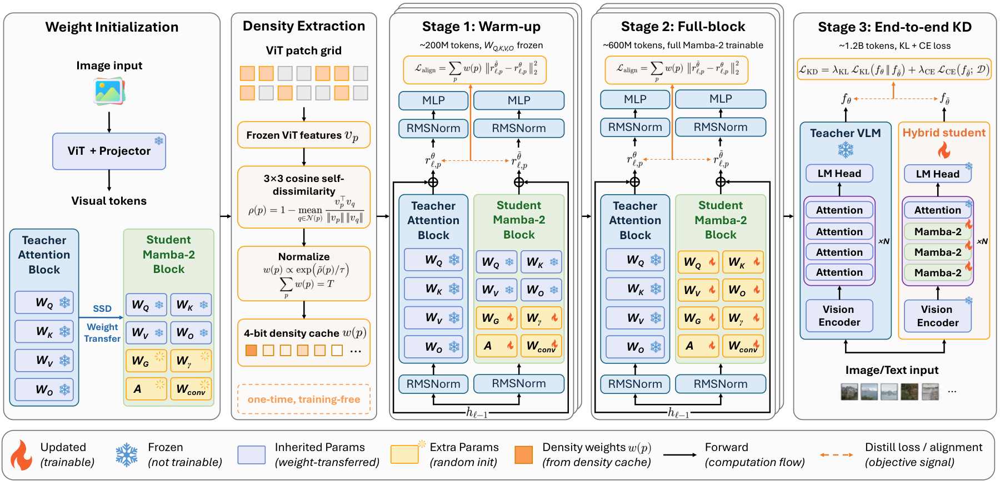

# HEED: Density-Weighted Residual Alignment for Hybrid Vision-Language Model Distillation

[](https://arxiv.org/abs/2605.17093)

Yihao Liang, Niraj K. Jha — Princeton University · NeurIPS 2026

HEED distills a vision-language model (Qwen3-VL-8B-Instruct) into a 3:1 Mamba-2/attention hybrid. It replaces uniform residual alignment with density-weighted residual alignment, using patch self-dissimilarity as a training-free proxy for which positions matter. HEED adds no parameters and no inference-time cost.

<p align="center"></p>

This repository contains Phase-1 distillation (conditions C1–C4), SFT and DPO post-training, SGLang serving of the student, and evaluation.

## Layout

| Path | What it does |
|---|---|
| `heed/mamba2.py` | Mamba-2 mixer with GQA-shaped projections; SSD weight transfer from attention ($C \leftarrow W_Q$, $B \leftarrow W_K$, $x \leftarrow W_V$, $W_O$); SSD scan via `flash-linear-attention` with a PyTorch reference; O(1)-per-token recurrent decoding through the transformers cache (the reference for serving) |
| `heed/hybrid.py` | One Qwen3-VL model that runs as teacher or as the 3:1 student (frozen modules are shared); stage-wise trainable sets; student checkpoints |
| `heed/density.py` | Patch density $\rho(p)$ (Eq. 2), weights $w(p)$ (Eq. 3, Alg. 1), 4-bit density cache |
| `heed/losses.py` | C2 HSA, C3 RSA (Eq. 4), C4 HEED (Eq. 5), Stage-3 KD (Eq. 1), DPO |
| `heed/data.py` | LLaVA-style jsonl → Qwen3-VL inputs |
| `train.py` | Three-stage distillation (10% / 30% / 60% of the token budget) for conditions `kd`, `hsa`, `rsa`, `heed` |
| `scripts/build_density_cache.py` | One-time density cache over the training set |
| `posttrain.py`, `heed/lora.py` | SFT and DPO of a distilled student |
| `heed/serving/`, `heed/configuration_heed.py` | The student in SGLang: its Qwen3-VL with SGLang's Mamba-2 kernels, state cache and continuous batching in the replaced layers |
| `scripts/export.py` | Student checkpoint → SGLang checkpoint dir (base weights symlinked) |
| `scripts/bench.py` | Teacher-vs-student TTFT, decode speed, throughput and cache size under SGLang |
| `eval/run_lmms_eval.sh` | lmms-eval on SGLang (greedy decoding) for the teacher or a student checkpoint |

## Setup

```bash
pip install -r requirements.txt               # training
pip install sglang==0.5.21 lmms-eval==0.7.4   # serving and evaluation, in a separate environment
```

SGLang's flashinfer kernels are compiled on first use, which needs the CUDA toolkit (`nvcc`) on `PATH`.

## Data

`train.py` reads a jsonl file with one sample per line:

```json
{"id": "...", "image": "images/x.png", "conversations": [{"from": "human", "value": "..."}, {"from": "gpt", "value": "..."}]}
{"id": "...", "text": "..."}
```

`posttrain.py` reads the same conversations for SFT; a DPO sample ends its conversation on a human turn and adds the two answers:

```json
{"id": "...", "image": "images/x.png", "conversations": [{"from": "human", "value": "..."}], "chosen": "...", "rejected": "..."}
```

Image paths are relative to `--image_root` (default: the jsonl's directory). The mixture of each phase is listed in App. C.3–C.5 of the paper; obtain each source under its own terms.

## Distillation

```bash
# C4 HEED, paper settings (2B tokens, 2M-token batches)
torchrun --nproc_per_node 8 train.py --train_data data/train.jsonl --output_dir outputs/heed

# controls: --condition kd | hsa | rsa
# optional precomputed density: python scripts/build_density_cache.py --train_data data/train.jsonl --out cache/density
#                               train.py ... --density_cache cache/density
```

Distillation checkpoints hold only the Mamba-2 blocks (`student.pt` + `heed_student.json`); `heed.hybrid.load_student` rebuilds the student on top of the base model.

## Post-training

SFT and DPO run in the training environment and train the student in PyTorch; the result is a student checkpoint, served and evaluated on SGLang like a distilled one:

```bash
torchrun --nproc_per_node 8 posttrain.py --phase sft --student outputs/heed/final --train_data data/sft.jsonl --output_dir outputs/sft
torchrun --nproc_per_node 8 posttrain.py --phase dpo --student outputs/sft/final --train_data data/dpo.jsonl --output_dir outputs/dpo
bash eval/run_lmms_eval.sh outputs/dpo/final all outputs/eval_dpo   # serving environment
```

Rank 0 keeps fp32 master weights and their Adam state in CPU memory: SFT peaks at about 190 GB of RAM.

## Inference and evaluation

Inference runs on SGLang; the commands below run in the serving environment. A student checkpoint is exported once (`eval/run_lmms_eval.sh` does it on first use), then served like any Qwen3-VL checkpoint:

```bash
python scripts/export.py outputs/heed/final                                # -> outputs/heed/final/export
bash eval/run_lmms_eval.sh Qwen/Qwen3-VL-8B-Instruct all outputs/eval      # teacher; or a comma-separated task list
bash eval/run_lmms_eval.sh outputs/heed/final all outputs/eval_heed        # student
```

Inference profile on one GPU (the paper's efficiency numbers come from vLLM):

```bash
python scripts/bench.py outputs/heed/final/export --out outputs/bench/student.json
python scripts/bench.py Qwen/Qwen3-VL-8B-Instruct --out outputs/bench/teacher.json
python scripts/bench.py --compare outputs/bench/teacher.json outputs/bench/student.json
```

To serve a student elsewhere: `SGLANG_EXTERNAL_MODEL_PACKAGE=heed.serving PYTHONPATH=<this repo> python -m sglang.launch_server --model-path <dir>/export --trust-remote-code`. Tensor parallelism is not implemented for the student.

## Citation

```bibtex
@inproceedings{liang2026heed,
  title     = {{HEED}: Density-Weighted Residual Alignment for Hybrid Vision-Language Model Distillation},
  author    = {Liang, Yihao and Jha, Niraj K.},
  booktitle = {Advances in Neural Information Processing Systems},
  year      = {2026},
  url       = {https://arxiv.org/abs/2605.17093}
}
```
